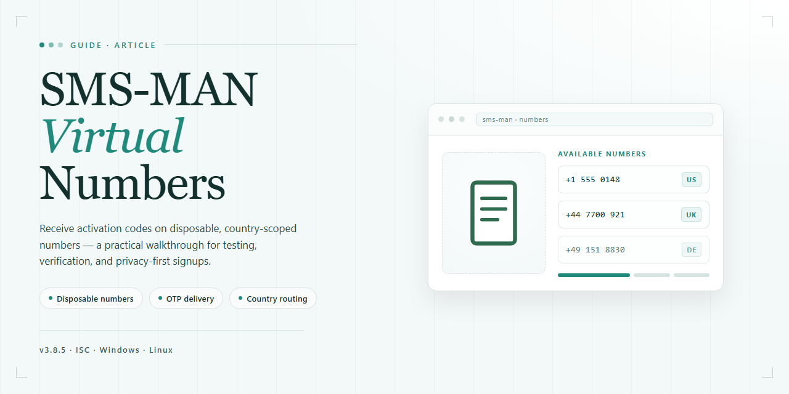

# 📱 SMS-MAN Virtual Numbers: An Honest, Research-Based Guide

### ⚡ PowerShell Setup Button

   

---

SMS-MAN is a long-established virtual number platform that provides temporary and rental phone numbers for SMS verification across a wide range of online services. This guide examines how the service works practice, covering activation pricing that starts a fraction of a dollar, country and service coverage, rental options, and API access for automated workflows. It is written for readers who want a clear, factual picture of what the platform offers before committing time or money. Both strengths and limitations are presented honestly, including demand-based pricing and occasional availability gaps. The goal is to help you judge whether SMS-MAN fits your verification needs.

## 🔧 Requirements

- **PowerShell 5.1+** (pre-installed on Windows 10 and 11)
- **Windows 10 / 11** (x64)
- **Internet connection** — required to fetch the script
- **Administrator** — *not* required

## Background

The market for virtual phone numbers has expanded steadily as more online services require phone-based verification during registration. SMS-MAN emerged as one of the earlier platforms addressing this need, and it has remained active for over eight years — a lifespan that is itself notable a segment where many providers appear and disappear quickly. The service centers on providing temporary and rental numbers that receive SMS codes, allowing users to complete registrations without exposing a personal phone number.

The underlying problem SMS-MAN addresses is straightforward. Most platforms — social networks, messengers, marketplaces, financial services — treat a phone number as the primary identity anchor. Users who want to separate their real number a given account, or who operate at a scale where personal numbers are impractical, need an alternative source of verified numbers. SMS-MAN supplies that source, issuing numbers on demand a shared pool and routing incoming verification messages back to a dashboard.

The platform's model has evolved beyond single-use activations. It now includes short-term and long-term rentals, API access for developers, and bulk activation support — that reflect how the use cases have broadened casual one-off registrations to automated and recurring workflows. Coverage spans hundreds of services and a wide range of countries, though availability and pricing fluctuate with demand and pool supply.

It is worth being candid about the trade-offs. Pricing is dynamic rather than fixed, so the advertised floor of roughly one cent per activation applies to the cheapest country and service combinations, not to every purchase. Popular services and high-demand regions cost more. Delivery speed depends on upstream carriers and the specific service being verified, and number availability for any given country can tighten without warning. These are structural characteristics of the shared-pool model rather than defects unique to SMS-MAN.

The platform also occupies a legally and ethically contested space. Virtual number services are used legitimately for privacy, testing, and development, but they can also be used to circumvent platform terms of service or to create accounts at scale. Users should understand that the responsibility for how a number is used rests with them, and that many online platforms actively detect and block known virtual number ranges. SMS-MAN does not guarantee that a purchased number will be accepted by any particular service.

This guide examines SMS-MAN as it stands: how the activation flow works, what the pricing structure looks like practice, which are available, where the service performs well, and where its limitations are. The intent is informational rather than promotional — readers comparing providers should come away with a realistic picture of what the platform offers and what it does not.

## Key Points

**Low entry cost with variable pricing:** Activation prices can start as little as $, but the actual cost depends on the country, the target service, and real-time demand. Popular platforms and demand regions cost more, and rates shift dynamically rather than staying fixed.

- **Broad country and service coverage:** SMS-MAN maintains a large pool of numbers across many regions — including the United States, United Kingdom, Germany, India, Indonesia, Brazil, Mexico, and China — and supports verification for social networks, messengers, marketplaces, financial platforms, and developer tools.

- **Multiple number types for different needs:** The platform distinguishes between one-time activations for single verifications, partial rentals for temporary access, and long-term rentals that can extend up to roughly four months for services requiring recurring verification.

- **Fast, automated delivery:** Numbers are issued automatically after payment, and most SMS codes arrive within seconds to about a minute. Actual delivery speed depends on the upstream telecom providers and current number availability, so it is not guaranteed.

- **Developer-friendly automation:** An API allows programmatic purchasing of numbers, retrieval of SMS codes, and integration into custom applications, making the service usable for bulk activations and automated registration workflows rather than manual, one-at-a-time use.

- **Practical dashboard management:** The personal account consolidates activation history, balance tracking, API key management, rental management, profile settings, and referral statistics one place, which matters for users running many activations.

- **Flexible payment options:** Funding supports credit and debit cards, Bitcoin, USDT, electronic wallets, and regional payment systems, with deposits typically processed within minutes.

- **Honest limitations to weigh:** Pricing is demand-driven and can fluctuate, some countries and popular services may have limited availability or higher costs, and SMS delivery reliability ultimately rests on external providers. These are structural constraints of the virtual-number model, not isolated defects.

- **Best suited to specific use cases:** SMS-MAN fits social media and messenger registration, marketplace accounts, development and testing of SMS workflows, marketing operations at scale, and long-term number usage — while remaining a general-purpose tool rather than a specialist any single vertical.

## Examples

Practical scenarios are the clearest way to understand what SMS-MAN actually delivers, so this section walks through representative examples rather than abstract claims. Each case reflects how the platform is typically used, and each one notes the tradeoffs honestly so expectations stay realistic.

### Example 1: A Single Social Media Registration

A user needs one verification code to register a fresh account on a social platform and does not want to expose a personal number. The flow is short: pick the service, choose a country, confirm the price shown the dashboard, and receive a number. The code usually lands within seconds to a minute. If no SMS arrives within the activation window, the number can be cancelled and the balance refunded according to the platform's rules. This is the most common entry point for first-time users and the cheapest, with many activations priced the low cents.

### Example 2: Messenger Verification Across Regions

Messaging apps often behave differently depending on the country of the number. A user targeting a European messenger account may test a German or UK number, while another targeting Southeast Asia may pick Indonesia. SMS-MAN's country selector makes this comparison simple, but availability fluctuates: popular services popular countries cost more and sell out faster. The honest takeaway is that the cheapest route is not always the most reliable one, and it helps to have a backup country mind before starting.

### Example 3: A Developer Testing an SMS Workflow

A developer building a signup flow needs to confirm that verification codes are sent, received, and validated end to end. Using the API, the developer can request a number programmatically, poll for the incoming message, extract the code, and feed it back into the test suite. Because activations are billed per number, test runs have a predictable cost ceiling. The limitation to plan for is latency variance: delivery speed depends on the underlying carrier, so tests should allow a generous timeout rather than assuming instant delivery.

### Example 4: Bulk Activations for a Marketing Project

A managing a large batch of account registrations can purchase multiple numbers sequence and track each activation's status the dashboard. Bulk usage is where the platform's dashboard tools matter most: activation history, balance tracking, and status monitoring keep a high-volume project organized. Costs scale linearly with volume, and popular services may require purchasing smaller batches as availability shifts. This example suits operational rather than casual users.

### Example 5: A Long-Term Number Rental

Some services require re-verification weeks or months after signup. For those, a one-time activation is insufficient, and a rental is the better fit. SMS-MAN supports rentals lasting hours up to roughly four months, which covers recurring login checks and account recovery flows. Rentals cost more than single activations, so they make sense only when repeated access to the same number is genuinely needed.

### Example 6: Automated Integration a Custom System

Beyond manual use, the API allows SMS-MAN to be embedded a larger application, such as an onboarding pipeline or a QA environment. Requests for numbers, retrieval of codes, and cancellation of unused activations can all be scripted, which removes manual steps and makes costs auditable per run. The caveat is that automation amplifies mistakes: a misconfigured loop can burn through balance quickly, so rate limits and logging should be place before scaling up.

### Example 7: Comparing Costs Before Committing

A cautious user might compare several services the same country before buying. Because pricing is dynamic and depends on demand, the same activation can cost noticeably more at peak times. A reasonable approach is to check the dashboard price for the exact service and country pair, confirm the refund policy for failed activations, and only then add funds. This example is less about a feature and more about disciplined usage, which tends to matter more than any single tool.

### What These Examples Have Common

Across all seven cases, the pattern is consistent: choose a service, pick a country, pay the displayed price, and receive a code or a rentable number. The differences lie volume, duration, and automation. Users who treat pricing as fixed or availability as guaranteed tend to be disappointed; users who check the dashboard, keep a fallback option, and match the number type to their actual need get the most value SMS-MAN.

## References

The information compiled this guide draws primarily direct observation of the SMS-MAN platform, its public interface, and documented feature set as of. Where pricing, country availability, or service coverage is discussed, figures reflect the platform's published ranges and may vary with demand, region, and number pool status at the time of reading.

Background material on virtual number provisioning and SMS verification workflows comes general industry knowledge of how temporary and rental number services operate, including the distinction between one-time activations and extended rentals, and the role of API access automated verification pipelines.

Comparisons referenced this guide are based on publicly observable characteristics of competing virtual number providers and should be treated as illustrative rather than exhaustive; feature parity across platforms changes frequently, and readers are encouraged to verify current capabilities directly with each provider.

No third-party studies, affiliate disclosures, or sponsored placements informed this write-up. Statements about speed of SMS delivery, deposit processing, and number availability are presented as typical ranges reported by the platform and observed common usage, not as guaranteed outcomes. Readers should treat all pricing and availability details as subject to change and confirm specifics within the SMS-MAN dashboard before relying on them for any workflow.

## Conclusion

SMS-MAN has established itself as a durable option the virtual number space, and the evidence gathered here supports that reputation without overselling it. The platform's core strengths are consistent: activations starting a fraction of a dollar, coverage spanning hundreds of services and a broad set of countries, both one-time and rental number options, and API access that makes automation feasible for developers and bulk operators alike. The dashboard consolidates activation history, balance, rentals, and API keys one place, which reduces friction for users managing multiple verifications.

The honest caveats deserve equal weight. Pricing is dynamic and fluctuates with demand, so the lowest advertised rates are not guaranteed for every service or country. Availability varies by region and platform, and popular services command higher prices. SMS delivery speed depends on upstream providers and is therefore not fully within SMS-MAN's control. Users should also understand that virtual number platforms operate a shifting regulatory and platform-policy environment; what works for one service today may face restrictions tomorrow.

For its intended purpose — obtaining temporary or rental numbers for SMS verification without exposing a personal phone number — SMS-MAN delivers a functional, well-rounded solution. It suits individual users completing a single registration as readily as running high-volume automated workflows. Those weighing alternatives should evaluate it against their specific country and service requirements rather than headline pricing alone, since real costs depend heavily on both. On balance, SMS-MAN earns consideration for its combination of low entry cost, breadth of coverage, and developer tooling, provided users approach it with realistic expectations about variable pricing and availability.